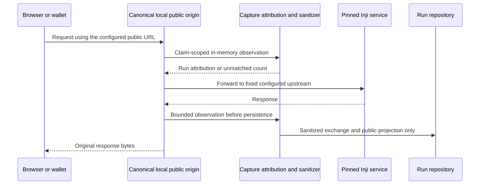

# Capture decision: passive HAR and a canonical local proxy

Date: 22 October 2026. Status: HAR implemented; canonical-proxy design accepted conditionally. No forwarding proxy or local Inji integration is implemented by this ADR.

D-039 remains the browser-capture decision for Collab. It does not rule out a reverse proxy configured as a local stack's public URL from the start. Our earlier wording that proxies necessarily intercept TLS or rewrite signed URLs was too broad.

| Capture point | Useful coverage | Preconditions and limits | Current state |
| --- | --- | --- | --- |
| Driver HTTP logging | Reference-role outgoing calls and responses | Does not see wallet/browser/server traffic outside the driver | Implemented |
| Passive HAR | Recorded browser HTTP calls | Post-hoc; cannot see server-to-server calls, wallet storage, native apps or encrypted content | Implemented with explicit coverage |
| Canonical-URL reverse proxy | HTTP calls that actually traverse configured public origins, including some server-to-server calls | Every applicable public URL, DID, redirect and audience must agree before issuance; internal service calls may still bypass it | Design only |
| TLS-intercepting proxy | Traffic from clients that trust its certificate | Operational/trust changes; inappropriate for a shared Collab sandbox | Not selected |

The proxy's URL must be the issuer/verifier public URL, not a later replacement for one already signed into a credential or request. Person 4 must configure and record: TLS termination and local DNS; Certify issuer/public endpoint metadata; Mimoto public issuer and callback URLs; Verify client/DID/request/response URLs; authentication client redirect registration; and fixed upstream service addresses. Inbound Host and forwarded-header behavior must follow the pinned service's deployment contract. Do not patch existing JWTs, DIDs, offers, redirects, audiences, cookies or response bodies to force a fit. Re-issue test material after public-URL configuration changes. Do not change public Collab configuration.

A future forwarder must use fixed upstreams from deployment configuration, not request-selected hosts. It needs timeout, streaming/backpressure, body caps, redirect policy, WebSocket policy if required, and health checks. Merely inserting the proxy does not establish complete FR-40 coverage: record each route that bypasses it and all encrypted/native/local boundaries.

## Attribution prototype and ownership seam

`apps/bff/src/capture/hub.ts` is a unit-tested attribution building block. It is disabled unless enabled explicitly (`CAPTURE_HUB_ENABLED=true`); setting that flag alone starts no listener and adds no capture route. It validates role/origin scope, leases a capture target for at most five minutes, counts unmatched requests without keeping their payloads, and refuses overlapping claims. It requires the right lease and zero in-flight requests before release. It stores neither request data nor credentials.

We deliberately refuse a newest-claim-wins rule: overlapping runs could silently receive each other's traffic. A future deployment must also serialize synthetic journeys, drain connections and allow a quiet interval between claims. A late request that arrives after an old claim ends cannot be reliably attributed by role alone. Where the protocol provides a public request/transaction identifier, use a separate validated correlation map; otherwise count ambiguous traffic as unmatched. A claim is attribution assistance, not cryptographic proof of the run or a complete journey.

Person 1 owns attribution, sanitization and capture tests. Person 4 owns public origins, upstream wiring, certificates and Compose. Person 2 owns any controls and inspector rendering. No proxy is to be enabled until those settings and a synthetic end-to-end test agree. At the existing **24 October 2026, 21:00 IST** A1/A2 cutoff, keep this as a design-only deliverable if the pinned local stack/public-URL configuration is unavailable. Competitor behavior supplied in the review is a design lead, not independently reproduced evidence.
