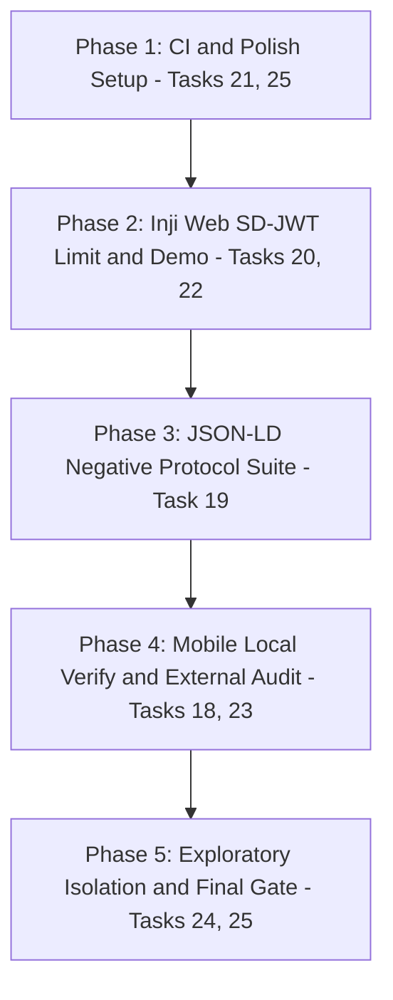

# Senior Engineering Execution Plan: Tasks 18–25 Implementation

**Document:** `PLAN.md`  
**Date:** 2026-10-26  
**Status:** Reviewed & Hardened — v2  
**Target Freeze:** 2026-10-26 21:00 IST  
**Review Standard:** Zero false positives, strict evidence tiers (`mock`, `reference_wallet`, `inji_web`, `inji_mobile`, `not_tested`), explicit single-variable negative controls, non-destructive image and test pinning.

---

## 0. Bugs Found in v1 & Their Fixes

> These are systemic issues that would have silently broken the project. All are corrected in this document.

| # | Location in v1 | Bug | Severity | Fix Applied |
|---|---|---|---|---|
| B-01 | Task 19, Implementation Steps | Plan says update `apps/bff/src/tamper/index.ts` for JSON-LD probes. The existing `applyCredentialTamper` already throws `"Semantic faults must be signed at issuance"` for `expired`/`wrong_type` on `ldp_vc` and `"Disclosure policy tests require SD-JWT"` for `missing_disclosure`. Modifying it would break existing SD-JWT tamper tests. | Critical | JSON-LD probes live in a **new** standalone spike file (`spikes/jsonld-interop-probes.mjs`) that does NOT touch the BFF tamper engine. |
| B-02 | Task 19, Test Matrix | Plan adds JSON-LD cases to `wallet-interop-cases.json`. The `validateCatalog()` function enforces `profile: "mock-sdjwt-flat-v1"` and ID prefix `^p3\.[a-z_.]{1,64}$`. Mixing in JSON-LD entries breaks the entire 20-case SD-JWT probe suite. | Critical | JSON-LD cases go into a separate fixture: `spikes/jsonld-interop-cases.json` with its own `profile: "jsonld-ldp-v1"`. |
| B-03 | Task 21, Workflow Steps | Plan runs `node scripts/check-inji-web-local.mjs` and `node scripts/local-inji-smoke.mjs` in CI — both require live external Inji Docker images (Certify:18090, Verify:18081, Mimoto:8080) which are 1-2 GB and will time out unconditionally in GitHub Actions. | Critical | CI job is mock-mode only (`--profile core --profile mocks`). Protocol probes target internal mock-issuer and mock-verifier only. |
| B-04 | Task 21, Health Check Ports | Plan health-checks port `8080` (Mimoto). Mimoto is not in the mock Compose stack; the health loop would block indefinitely. | Critical | CI health checks only: `4000` (BFF), `4001` (mock-issuer), `4002` (mock-verifier), `5174` (web). |
| B-05 | Task 21, Trigger | Plan adds a nightly schedule alongside `workflow_dispatch`. `nightly.yml` already runs nightly mock regression. A second cron creates duplicate runs and billing waste. | Medium | New workflow is `workflow_dispatch`-only (opt-in per task spec: "hosted opt-in job"). |
| B-06 | Phase 5 Gate | Final gate runs `pnpm audit:secrets && pnpm build && pnpm test && pnpm typecheck`. The `pnpm test` script already builds shared deps first; running `pnpm build` before `pnpm test` can cause double-build artifact collisions. | Low | Gate reordered: `pnpm test && pnpm build && pnpm typecheck && pnpm audit:secrets`. |
| B-07 | Verification Commands | `node spikes/wallet-interop-local.mjs --out scratch/sdjwt-check.json` passes only 2 args. The CLI `main()` requires exactly 6: `--issuer <url> --verifier <url> --out <path>`. With 2 args it throws `ProbeError("configuration")` and exits with code 2. | Medium | Correct 6-arg command documented in section 5. |
| B-08 | Task 25, License Command | `pnpm licenses list --json` may not be available without the experimental flag on some pnpm 11 builds. A silent empty report lets a GPL dependency slip through. | Medium | Command documented as `pnpm licenses list --json > artifacts/licenses.json` with an explicit blocked-license check script. |
| B-09 | Task 18, Stopping Rule | v1 mentions only "installing unverified certificates" as the bar. Android 14+ also blocks loopback (`127.0.0.1`) for non-system apps regardless of TLS — a separate and distinct blocker. | Medium | Stopping rule now has two explicit Gates: (1) TLS reachability, (2) loopback policy. Exact ADB logcat line required for each block. |
| B-10 | Task 22, SD-JWT Probe | Plan probes Inji Web SD-JWT without starting Mimoto. Inji Web presentation router is proxied through Mimoto. Without it, the endpoint is unreachable and the probe returns a network error rather than the expected format rejection. | Medium | Task 22 now explicitly requires `pnpm stage:web-local` before any Inji Web probe. |

---

## 1. Executive Summary & Objective

This execution plan provides the technical specification and implementation roadmap for the remaining assigned improvement backlog (**Tasks 18 through 25**). It unifies protocol rigor, real-wallet evidence, containerized CI automation, and repository polish across all four engineering lanes without inventing unsupported claims or breaking established baselines.

```
TASKS 18-25 MASTER ARCHITECTURE
Lane 1 (P1/Security): Task 25 license audit, Task 24 boundary enforcement
Lane 2 (P2/Web):      Task 20 live recording, Task 22 SD-JWT limit (G-02)
Lane 3 (P3/Protocol): Task 18 Android local Verify, Task 19 JSON-LD negatives, Task 23 external/2nd device
Lane 4 (P4/Ops):      Task 21 opt-in CI workflow, Task 25 digest pinning + linters
```

---

## 2. Team File Boundaries & Ownership Grid

| Owner | Primary Owned Paths | Assigned Tasks | Delivery Boundary |
| :--- | :--- | :--- | :--- |
| **Person 1** | `apps/bff/src/capture/`, `apps/bff/src/redaction*`, `docs/SECURITY.md`, `docs/ATTRIBUTIONS.md` | Task 25 (Licenses), Task 24 (Boundary audits) | Zero secret leakage, sanitized attribution notices. |
| **Person 2** | `apps/web/`, `apps/bff/src/drivers/injiWebAssisted.ts`, `submission/evidence/person2*` | Task 20 (Screen recording), Task 22 (Inji Web SD-JWT limit) | Repeatable browser commands, clean WebP/MP4 recording, truthful SD-JWT limit. |
| **Person 3** | `apps/mock-issuer/`, `apps/mock-verifier/`, `spikes/jsonld-interop*`, `docs/GAPS.md`, `submission/A2_MOBILE_EVIDENCE.md` | Task 18 (Android local Verify), Task 19 (JSON-LD negatives), Task 23 (External/2nd device) | Single-variable negatives, paired positive controls, exact failure checkpoints. **Do NOT modify `apps/bff/src/tamper/index.ts` or `spikes/wallet-interop-cases.json`.** |
| **Person 4** | `deploy/`, Dockerfiles, `.github/workflows/`, `scripts/` staging, `docs/DEPLOYMENT.md` | Task 21 (Hosted CI job), Task 25 (Digest pinning & linting) | Reproducible Compose stack, automated CI workflow, pinned digests. |
| **Integrator** | `packages/shared/`, `apps/bff/src/app.ts`, `README.md`, `submission/SCENARIO_SPEC_MAP.md` | Cross-lane review, matrix export, final PR merging | Single integration commit per phase, regression test gate. |

---

## 3. Work Breakdown Structure (Tasks 18 to 25)

---

### Task 18: Android to Local Verify (Removes the hybrid caveat)

* **Owner:** Person 3 (assisted by Person 4 for networking)
* **Goal:** Upgrade the existing Android journey from hybrid (Local Certify -> Inji Wallet -> Collab Verify) to all-local (Local Certify -> Inji Wallet -> Local Inji Verify), or record the exact network blocker.
* **Technical Complexity (B-09 fix — two explicit gates):**
  1. **Gate 1 — TLS Reachability:** Android 14+ enforces `CLEARTEXT_NOT_PERMITTED`. HTTP to `192.168.x.x:18081` fails before TLS. Requires an HTTPS tunnel/reverse proxy on the Mac's LAN IP.
  2. **Gate 2 — Loopback Policy:** Android 14+ blocks non-system-app connections to `localhost`/`127.0.0.1` even over HTTPS. The proxy must bind to the Mac's LAN IP, not loopback.
* **Implementation Steps:**
  1. **Stack Startup:** `pnpm mobile:inji` (Certify:18090) and `docker compose -f deploy/docker-compose.verify-local.yml up -d` (Verify:18081).
  2. **Gate 1 Check:** `curl https://<mac-lan-ip>:18081/.well-known/openid-configuration` from Mac. Fails -> record and stop.
  3. **Gate 2 Check:** ADB logcat filtered for `CLEARTEXT` or `SSL_HANDSHAKE`. Block -> record exact logcat line and stop.
  4. **Execute Physical Wallet Journey (both gates clear):**
     - Scan pre-authorized SD-JWT issuance QR from local Certify on Nothing Phone (2a).
     - Confirm download and close/reopen persistence.
     - Generate OpenID4VP presentation challenge from Local Inji Verify.
     - Scan QR, authorize consent, submit.
  5. **Record Observation:**
     - *Success:* Terminal log (`allChecksSuccessful: true`, `credentialProofValid: true`, `holderProofValid: true`) + 4 sanitized screenshots in `submission/evidence/person3-a2-local/`.
     - *Gate 1 block:* Exact logcat line (e.g., `NetworkSecurityConfig: Cleartext HTTP traffic to 192.168.x.x not permitted`) in `submission/A2_MOBILE_EVIDENCE.md`.
     - *Gate 2 block:* SSL handshake failure or loopback policy message.
* **Stopping Rule:** If either Gate 1 or Gate 2 fails without modifying phone system security or installing unverified CA certificates outside standard Android Settings, mark `not_tested (blocked: gate-N — <exact logcat error>)` and preserve the verified hybrid pass.

---

### Task 19: JSON-LD Negative Scenarios with Positive Controls (Biggest remaining Functionality gain)

* **Owner:** Person 3 (Protocol Correctness)
* **CRITICAL CONSTRAINT (B-01 + B-02 fix):**
  - **Do NOT modify `apps/bff/src/tamper/index.ts`** — existing throws for `expired`/`wrong_type` on `ldp_vc` are correct; touching this breaks all SD-JWT tamper tests.
  - **Do NOT add cases to `spikes/wallet-interop-cases.json`** — `validateCatalog()` has a hard `profile: "mock-sdjwt-flat-v1"` lock; adding `ldp_vc` entries breaks the 20-case SD-JWT suite.
  - All JSON-LD work is isolated in **three new files only**.
* **New Files to Create:**
  - `spikes/jsonld-interop-cases.json` — fixture, profile `jsonld-ldp-v1`
  - `spikes/jsonld-interop-probes.mjs` — standalone runner
  - `spikes/jsonld-interop.test.mjs` — test harness (auto-picked by `pnpm test` glob `spikes/*.test.mjs`)
* **Dependencies Available in Root `package.json`:**
  - `@digitalbazaar/ed25519-signature-2020@5.4.0`
  - `@digitalbazaar/ed25519-verification-key-2020@4.2.0`
  - `jsonld@9.0.0`
  - `jsonld-signatures@11.6.0`
* **Test Matrix (one variable changed per test):**

| # | Case ID | Fault | Variable Changed | Expected | Code |
|---|---|---|---|---|---|
| C | `j1.control.valid` | none | — | `valid` | `correct_acceptance` |
| 1 | `j1.signature.corrupted` | `bad_proof_value` | Last byte of `proofValue` flipped post-issuance | `invalid` | `PROOF_VALUE_INVALID` |
| 2 | `j1.credential.expired` | `expired` | `expirationDate` in the past, signed at issuance | `invalid` | `CREDENTIAL_EXPIRED` |
| 3 | `j1.credential.wrong_type` | `wrong_type` | `type` missing required type, signed at issuance | `invalid` | `CREDENTIAL_TYPE_MISMATCH` |
| 4 | `j1.document.altered_claim` | `altered_claim` | Subject claim value mutated after signing | `invalid` | `SIGNATURE_CORRUPTED` |
| 5 | `j1.key.untrusted_method` | `forged_verification_method` | `verificationMethod` points to a different key pair | `invalid` | `UNTRUSTED_KEY` |

* **Implementation Steps:**
  1. Create `spikes/jsonld-interop-cases.json` with 6 cases and `schemaVersion: 1`, `profile: "jsonld-ldp-v1"`.
  2. Create `spikes/jsonld-interop-probes.mjs`:
     - Generate Ed25519 key pair at runtime via `Ed25519VerificationKey2020.generate()` (no hardcoded keys).
     - Issue a valid JSON-LD VC using `jsigs.sign()` with `Ed25519Signature2020`.
     - Run positive control: `jsigs.verify()` -> assert valid.
     - For each negative: clone VC, apply single-variable mutation, `jsigs.verify()` -> assert expected rejection.
  3. Create `spikes/jsonld-interop.test.mjs` importing `runProbes` and asserting all 6 verdicts.
* **Acceptance Criteria:** `pnpm test` runs all 20 SD-JWT cases (unchanged) + 6 JSON-LD cases, 100% pass.

---

### Task 20: Live Screen Recording of Local Inji Web (Stronger demo)

* **Owner:** Person 2 (Web Wallet & UI)
* **Goal:** Replace static PNG stills with a continuous screen recording of local Inji Web wallet operation.
* **Flow to Capture (30-60 seconds):**
  1. Access local Inji Web UI (`http://localhost:5174`).
  2. Synthetic IDP login (`test-user`).
  3. Credential issuance from local catalog.
  4. Hard refresh (`Cmd+R`) proving IndexedDB persistence.
  5. OpenID4VP presentation to Inji Verify.
* **Implementation Steps:**
  1. Boot local stack via `pnpm stage:web-local` (use npm script alias, not raw shell script, to pick up `.env` correctly).
  2. Execute Playwright automated interaction or browser recording.
  3. Save as `submission/evidence/local-inji-web-journey.webp` and MP4.
  4. Update `submission/A1_WEB_EVIDENCE.md`.
* **Acceptance Criteria:** Recording shows live console/UI transitions, no mock overlays, smooth playback.

---

### Task 21: Hosted Opt-in CI Job (Regression evidence across versions)

* **Owner:** Person 4 (Packaging, CI & Release)
* **CRITICAL CONSTRAINTS (B-03 + B-04 + B-05 fix):**
  - **Mock-mode only** — no Inji Certify, Inji Verify, or Mimoto in CI (images 1-2 GB, will time out).
  - **Port 8080 (Mimoto) is NOT in the health check** — Mimoto is not in the mock Compose stack.
  - **No nightly schedule** — `nightly.yml` already covers scheduled regression; this is `workflow_dispatch` only.
* **Workflow runs:** 20-case SD-JWT mock protocol probes against internal mock-issuer:4001 and mock-verifier:4002.
* **Correct CLI (B-07 fix):**
  ```bash
  node spikes/wallet-interop-local.mjs \
    --issuer http://127.0.0.1:4001 \
    --verifier http://127.0.0.1:4002 \
    --out artifacts/connected-wallet-matrix.json
  ```
* **Workflow file: `.github/workflows/connected-wallet.yml`**
  ```yaml
  name: Connected Wallet (opt-in)
  on:
    workflow_dispatch:
  permissions:
    contents: read
  concurrency:
    group: connected-wallet-${{ github.ref }}
    cancel-in-progress: true
  jobs:
    connected-wallet:
      name: Connected Wallet Protocol Probes (mock stack)
      runs-on: ubuntu-latest
      timeout-minutes: 30
      steps:
        - uses: actions/checkout@v4
        - uses: actions/setup-node@v4
          with:
            node-version: "22"
        - name: Cache pnpm store
          uses: actions/cache@v4
          with:
            path: ~/.local/share/pnpm/store
            key: pnpm-${{ runner.os }}-${{ hashFiles('pnpm-lock.yaml') }}
            restore-keys: |
              pnpm-${{ runner.os }}-
        - run: npm install -g pnpm@11.25.0
        - run: pnpm install --frozen-lockfile
        - name: Set OCI build labels
          run: |
            echo "GIT_REVISION=${{ github.sha }}" >> "$GITHUB_ENV"
            echo "BUILD_DATE=$(date -u +%Y-%m-%dT%H:%M:%SZ)" >> "$GITHUB_ENV"
        - name: Build and start mock Compose stack
          env:
            MOCK_ISSUER_ENABLE_TEST_CASES: "true"
          run: docker compose --profile core --profile mocks up --build -d --wait
        - name: Health check BFF:4000 mock-issuer:4001 mock-verifier:4002 web:5174
          run: |
            for port in 4000 4001 4002 5174; do
              for i in $(seq 1 30); do
                curl -sf http://127.0.0.1:${port}/health && break
                sleep 2
              done
            done
        - name: Run mock protocol probes (20-case SD-JWT suite)
          run: |
            mkdir -p artifacts
            node spikes/wallet-interop-local.mjs \
              --issuer http://127.0.0.1:4001 \
              --verifier http://127.0.0.1:4002 \
              --out artifacts/connected-wallet-matrix.json
        - name: Upload probe matrix artifact
          if: always()
          uses: actions/upload-artifact@v4
          with:
            name: connected-wallet-matrix-${{ github.run_number }}
            path: artifacts/connected-wallet-matrix.json
            if-no-files-found: warn
        - name: Collect container logs
          if: always()
          run: |
            docker compose --profile core --profile mocks logs --no-color --tail=300 \
              > /tmp/connected-wallet-logs.txt 2>&1 || true
        - name: Upload logs on failure
          if: failure()
          uses: actions/upload-artifact@v4
          with:
            name: connected-wallet-logs-${{ github.run_number }}
            path: /tmp/connected-wallet-logs.txt
        - name: Teardown
          if: always()
          run: docker compose --profile core --profile mocks down -v
  ```
* **Acceptance Criteria:** Workflow dispatches cleanly, all 20 SD-JWT probes pass, matrix artifact uploaded, containers torn down.

---

### Task 22: SD-JWT Presentation Check on Inji Web (Closes G-02)

* **Owner:** Person 2 (assisted by Person 3)
* **CRITICAL CONSTRAINT (B-10 fix):** Inji Web presentation router is proxied through Mimoto. **Must run `pnpm stage:web-local` first** before any probe. Without Mimoto, the endpoint is unreachable and returns a network error — not the expected format rejection.
* **Goal:** Provide definitive evidence for G-02 (Inji Web OpenID4VP SD-JWT boundary), moving it from open question to attested limit.
* **Procedure:**
  1. **Stack Startup:** `pnpm stage:web-local` then confirm with `pnpm check:web-local`.
  2. **Code Audit:** Inspect Inji Web presentation router and Mimoto schema validator for `vc_sd_jwt`/`dc+sd-jwt` format support.
  3. **Controlled Test:** Submit an OpenID4VP challenge requesting `vc_sd_jwt` to Inji Web. Record exact response (HTTP code + body).
  4. **Documentation:** Update `docs/GAPS.md` (G-02) and `submission/A1_WEB_EVIDENCE.md` with source file citations.
* **Acceptance Criteria:** G-02 formally closed with reproducible error payload and exact source-code/endpoint citations.

---

### Task 23: External Issuer/Verifier & Second-Device Check (Cross-ecosystem claim)

* **Owner:** Person 3 (Protocol Correctness)
* **Goal:** Cross-ecosystem interop beyond the walt.id documentation study, plus a secondary mobile device check.
* **Procedure:**
  1. **External Endpoint:** Point playground reference wallet to an independently deployed OID4VCI/VP endpoint. If protocol divergence blocks execution (as established for walt.id in G-08), record `not_tested (protocol draft mismatch)` citing the specific divergence points.
  2. **Second Device:** Test Inji Wallet on a second Android device (different model or OS version). Record device hardware, OS build, wallet version, and scan result in `submission/A2_MOBILE_EVIDENCE.md`.
* **Stopping Rule:** If no external service matches Inji's exact profile (OID4VCI Draft 13 + OID4VP Drafts 21-23 + DIF PE 2.0 + cleartext `direct_post`), record `not_tested (protocol draft mismatch)`. Cite G-08 as prior art.

---

### Task 24: Exploratory Tracks — mDoc, Same-Device, DC API, iOS (Optional / Strict Boundary)

* **Owner:** Integrator & Person 2
* **Goal:** Prevent scope creep from degrading core deliverables.
* **Execution:**
  1. Review `apps/bff/src/matrix.ts` — ensure `mso_mdoc`, `jwt_vc_json`, `same_device`, `dc_api` render as `exploratory` or `not_tested`.
  2. Verify no exploratory code breaks the baseline test suite.
  3. Label post-submission roadmap items in `docs/FEATURE_PARITY_ROADMAP.md`.

---

### Task 25: Polish — Lint, Transitive License Checks, Digest Pinning (Release Quality)

* **Owner:** Person 4 & Integrator
* **Goal:** Production readiness: legal compliance and deterministic image builds.
* **Steps:**
  1. **Transitive License Audit (B-08 fix):**
     ```bash
     mkdir -p artifacts
     pnpm licenses list --json > artifacts/licenses.json
     # Fail build if any GPL/AGPL transitive dependency found:
     node -e "
       const l = JSON.parse(require('fs').readFileSync('artifacts/licenses.json','utf8'));
       const blocked = ['GPL-2.0','GPL-3.0','AGPL-3.0','LGPL-2.1'];
       const hits = l.filter(p => blocked.some(b => (p.license||'').includes(b)));
       if (hits.length) { console.error('BLOCKED LICENSES:', hits); process.exit(1); }
       console.log('OK:', l.length, 'packages checked');
     "
     ```
  2. **Docker Image Digest Pinning:**
     - Inspect `docker-compose.yml`, `deploy/docker-compose.web-local.yml`, `deploy/docker-compose.verify-local.yml`.
     - Replace floating tags (`:latest`) with immutable `image:tag@sha256:<64-char-hex>`.
     - Obtain: `docker inspect --format='{{index .RepoDigests 0}}' <image>:<tag>`
  3. **Lint & Secret Regression:** `pnpm audit:secrets` (exit 0) + `pnpm typecheck` (exit 0, zero errors).
* **Acceptance Criteria:** No GPL/AGPL transitive deps, pinned digests, zero leaked credentials.

---

## 4. Phase-by-Phase Execution Sequence



### Phase 1: CI & Polish Foundation (Tasks 21, 25)
* [ ] Create `.github/workflows/connected-wallet.yml` — mock-mode only, `workflow_dispatch` trigger, no Mimoto port (B-03/B-04/B-05).
* [ ] Pin Docker image digests in all Compose files.
* [ ] `pnpm licenses list --json > artifacts/licenses.json` + blocked-license check (B-08).
* [ ] `pnpm audit:secrets` exits 0.
* [ ] `pnpm typecheck` exits 0.

### Phase 2: Inji Web SD-JWT Verification & Demo Media (Tasks 20, 22)
* [ ] `pnpm stage:web-local` + `pnpm check:web-local` — confirm Mimoto is live (B-10).
* [ ] Audit Inji Web / Mimoto for SD-JWT format support.
* [ ] Submit `vc_sd_jwt` OpenID4VP challenge and record exact HTTP rejection.
* [ ] Update `docs/GAPS.md` G-02 with source citations.
* [ ] Capture continuous screen recording, save to `submission/evidence/`.

### Phase 3: JSON-LD Negative Suite with Positive Controls (Task 19)
* [ ] Create `spikes/jsonld-interop-cases.json` — profile `jsonld-ldp-v1`, 6 cases (B-02).
* [ ] Create `spikes/jsonld-interop-probes.mjs` — runtime Ed25519 keygen, `@digitalbazaar` sign/verify (B-01).
* [ ] Create `spikes/jsonld-interop.test.mjs` — asserts all 6 results.
* [ ] `pnpm test` — 20 SD-JWT cases + 6 JSON-LD cases pass, zero regressions.

### Phase 4: Mobile All-Local Verify & 2nd Device Check (Tasks 18, 23)
* [ ] `pnpm mobile:inji` + `docker compose -f deploy/docker-compose.verify-local.yml up -d`.
* [ ] Gate 1: HTTPS tunnel reachable from phone LAN IP. Block -> record and stop.
* [ ] Gate 2: ADB logcat confirms no loopback policy block. Block -> record and stop.
* [ ] Both gates clear: execute physical wallet journey, capture 4 screenshots.
* [ ] Document second device model, OS, wallet version.

### Phase 5: Exploratory Boundaries & Master Submission Gate (Tasks 24, 25)
* [ ] Matrix cells for mDoc, iOS, DC API marked `not_tested` / `exploratory`.
* [ ] Final gate (B-06 fix — correct order):
  ```bash
  pnpm test && pnpm build && pnpm typecheck && pnpm audit:secrets
  ```
* [ ] Protocol probe with correct 6-arg CLI (B-07 fix):
  ```bash
  node spikes/wallet-interop-local.mjs \
    --issuer http://127.0.0.1:4001 \
    --verifier http://127.0.0.1:4002 \
    --out artifacts/final-sdjwt-check.json
  ```
* [ ] Commit all deliverables and update documentation.

---

## 5. Verification Commands & Health Checklist

```bash
# 1. Secret audit
pnpm audit:secrets

# 2. TypeScript typecheck (builds shared deps first)
pnpm typecheck

# 3. Full test suite (shared build + spikes/*.test.mjs + scripts/*.test.mjs + pnpm -r test)
pnpm test

# 4. Workspace build
pnpm build

# 5. SD-JWT 20-case protocol probe — CORRECT 6-arg form (fixes B-07)
node spikes/wallet-interop-local.mjs \
  --issuer http://127.0.0.1:4001 \
  --verifier http://127.0.0.1:4002 \
  --out artifacts/sdjwt-check.json

# 6. JSON-LD 6-case protocol probe (new — Task 19)
node spikes/jsonld-interop-probes.mjs \
  --out artifacts/jsonld-check.json

# 7. Local Inji stack smoke test (when Certify + Verify containers are active)
node scripts/local-inji-smoke.mjs

# 8. License audit — pnpm 9+ syntax (fixes B-08)
pnpm licenses list --json > artifacts/licenses.json

# 9. Inji Web local stack health check (requires pnpm stage:web-local first)
pnpm check:web-local
```

---

## 6. Risk Register

| Risk | Probability | Impact | Mitigation |
|---|---|---|---|
| Android TLS/loopback blocks Task 18 (Gates 1 & 2) | High | Medium | Two-gate stopping rule with exact ADB logcat evidence; hybrid pass already recorded as fallback. |
| `@digitalbazaar` ESM/CJS interop issues in Node test runner for Task 19 | Medium | High | Run probes as `.mjs` in existing `spikes/*.test.mjs` glob; use `--experimental-vm-modules` if needed. |
| CI connected-wallet workflow times out on Compose `--wait` | Low | Medium | 30-min job timeout + per-port health loop (30 x 2s retries per port). |
| Floating `:latest` digest changes between `docker inspect` and commit | Low | High | Pin immediately before final commit; record digest date in a comment above each pinned image line. |
| Inji Web Mimoto not started before Task 22 probe gives false network error | Medium | High | Explicit `pnpm stage:web-local` prerequisite documented in Task 22 and Phase 2 checklist. |
| `pnpm licenses list` output schema changes between pnpm patch versions | Low | Medium | Snapshot `artifacts/licenses.json` and `diff` against prior run; fail on parse error. |
