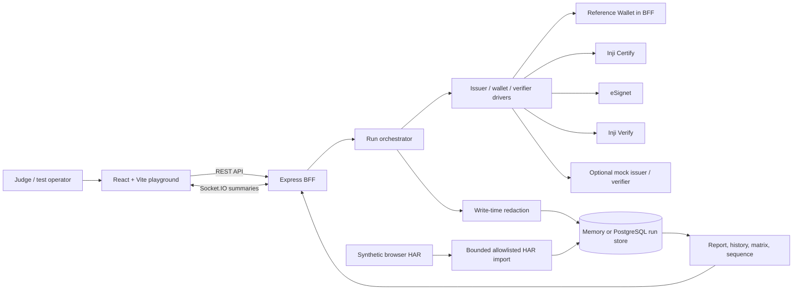

# Implemented architecture

The operator chooses a scenario or role combination. The BFF creates a run, executes named steps through adapters, redacts each exchange before storage, and sends small Socket.IO events. The web app fetches stored run details and renders the timeline, inspector, sequence, reports, and latest-result matrix. Reports label fixture, mock, and Reference Wallet evidence separately.

`PLAYGROUND_DRIVER_MODE=fixture` uses deterministic local responses. `collab` uses Inji Certify/eSignet and Inji Verify with the automated Reference Wallet; optional independent mocks can take an issuer or verifier role. The BFF keeps live credentials, tokens, keys, and cookies in per-run memory and stores sanitized exchange summaries. Browser HAR import observes synthetic traffic after a run; it never forwards or rewrites signed protocol requests.

The diagram covers the common run pipeline. The [managed local Web record](evidence/2026-10-26-person2-local-ui/run-report.json) traces the separate Certify → Inji Web/Mimoto → Verify journey. The Android page reads the manual evidence catalog. Mobile validation uses the existing Inji Wallet app; the team is not building a new mobile app. `pnpm demo:docker` now packages the playground, PostgreSQL, and separate mocks; it does not package local Inji services. See [DEPLOYMENT.md](../docs/DEPLOYMENT.md).
