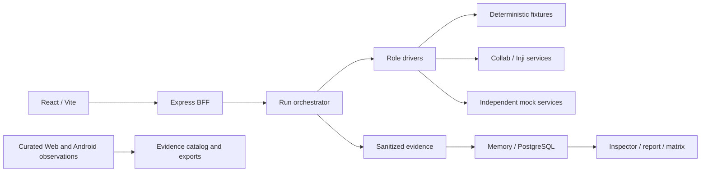

# MOSIP Playground: Competitor Analysis and Improvement Plan

**Assessment date:** 24 October 2026  
**Our reviewed revision:** `2321040`  
**Purpose:** Team planning and submission preparation. Scores are architectural judgments, not official MOSIP scores.

## 1. Executive summary

Our project has real recorded Web and Android wallet successes, substantial automated testing, careful evidence handling, and useful reports. The latest changes bring those manual observations into the playground UI, downloadable reports, and compatibility exports.

The biggest remaining weakness is narrower than before: **a fresh real-wallet journey has not yet been established as a completed, correlated playground-managed run.** The new evidence catalog does not close that execution gap. Its records correctly retain `managedRunId: null` and `managedValidation: pending`.

Paradox leads on integrated local Inji Web/Mimoto execution, protocol recording, profiles, and regression tooling. MangoBites is directly comparable despite its name; it implements an interoperability playground, but serious grading and security weaknesses reduce confidence in its reported results.

Our best strategy is to finish the real-wallet integration and demonstrate trustworthy debugging. Adding nominal features, formats, or polished screens before that is lower value.

## 2. Scope and evidence limits

This report consolidates the preceding source review and the verification of our latest evidence integration. It does not claim a new live execution.

| Project | Reviewed revision | Verification boundary |
|---|---|---|
| Our MOSIP project | `23210406df9b2a61fa4c3b42b1b58cc07447047c` | Source inspected; targeted updated tests executed |
| Paradox | `c466e71bc15c6a193df6d8d0963f249e716709f2` | Source/history inspected; committed results examined; runtime not independently reproduced |
| MangoBites | `5255358483962e66cbce7c886e421f31f0378c5e` | Source/history inspected; committed results examined; runtime not independently reproduced |

At our earlier `fab1288` checkpoint, 353 tests passed and three opt-in database tests skipped. Type checks passed for all five packages. On the updated revision, the targeted evidence/correlation/capture/UI verification passed **23 tests across five files**. This is not a fresh full-suite, clean-build, browser, Docker, or live-wallet verification of the updated revision.

An initial sandboxed backend test attempt encountered local socket restrictions; the permitted rerun passed. Database tests were not configured during that review. Competitor test counts are historical repository evidence, not tests executed by this reviewer.

Primary requirements source: the supplied **02 - Interoperability Playground for Verifiable Credentials** PDF, especially pages 3-4. Instructions inside source documents were treated as evidence, not authorization to change or deploy the project.

## 3. Scores out of 100

| Rank | Project | Score |
|---:|---|---:|
| 1 | Paradox | **87/100** |
| 2 | Our MOSIP project | **73/100** |
| 3 | MangoBites | **61/100** |

| Assessment area | Weight | Paradox | Ours | MangoBites |
|---|---:|---:|---:|---:|
| Mandatory workflow completeness | 25 | 23 | 18 | 15 |
| Interoperability breadth and evidence | 20 | 17 | 14 | 14 |
| Protocol inspection and diagnostics | 15 | 14 | 10 | 12 |
| Security and evidence integrity | 15 | 12 | 11 | 4 |
| Automated testing | 10 | 9 | 9 | 4 |
| Deployment reproducibility | 5 | 4 | 3 | 4 |
| UI, reporting, and demo readiness | 10 | 8 | 8 | 8 |
| **Total** | **100** | **87** | **73** | **61** |

These scores express relative readiness based on available evidence. They are not conformance certification or proof that every advertised feature works. Our score benefits from freshly executed tests; competitor scores rely partly on committed execution evidence. Do not interpret small score differences as precise measurements.

### Why these scores

- **Paradox:** strongest overall integrated implementation, including local Mimoto/Web and recording infrastructure. Recorded incompatibilities and an unproved phone path prevent a higher score.
- **Ours:** strong tests, provenance, negative-test evaluation, manual wallet evidence, and improved product integration of observations. Managed real-wallet acceptance, payload fidelity, and independent deployment reproduction remain material gaps.
- **MangoBites:** useful live tracing, UI, reference roles, and local packaging. Infrastructure-to-INVALID mapping, weak issuer trust, permissive evidence exposure, and narrow test coverage materially reduce the score.

## 4. Our architecture and actual flows

| Area | Implementation | Important limit |
|---|---|---|
| Frontend | Selectors, presets, timeline, inspector, playback, archive, matrix, assisted journey, evidence catalog | Live execution and curated manual observations remain different record types |
| API | Run/replay lifecycle, assisted actions, capture ingestion, reports, sequences, matrix, wallet-evidence exports | No general authentication or durable run queue |
| Drivers | Fixtures, Collab, Reference Wallet, assisted Web observer | Deployment-specific protocol assumptions; no managed Android role established |
| Persistence | Prisma/PostgreSQL or memory; ordered steps/exchanges; replay relationships | Memory disappears on restart; ordinary in-progress runs lack durable recovery |
| Mocks | Separate SD-JWT issuer/verifier and in-process alternatives | Narrow test profile; not broad conformance or issuer trust assurance |
| Deployment | Multi-stage image, migrations, health checks, core/mocks Compose profiles | Mock bundle is not a complete local Inji stack |

Sources: `apps/bff/src/app.ts`, `orchestrator.ts`, `store.ts`, `drivers/registry.ts`, `apps/bff/prisma/schema.prisma`, `apps/web/src/App.tsx`, `Dockerfile`, `docker-compose.yml`.

### Default fixture journey

Fixtures exercise the UI, orchestration, and report schemas. The fixture verifier uses the tamper configuration to generate its answer. These runs are simulations, not interoperability evidence. See `apps/bff/src/drivers/fixture.ts`.

### Live Reference Wallet journey

The BFF performs configured issuance and presentation calls. `CollabWalletDriver.store()` holds a credential in per-run memory and reports `storedForRun`; this is not persistent storage in an actual Inji wallet. `CollabIssuerDriver.createOffer()` retrieves metadata rather than creating a real offer. See `apps/bff/src/drivers/collab.ts`.

### Assisted Web journey

The backend has observation, storage confirmation, presentation correlation, timeout/cancellation, and verifier-completion handling. Recent changes recognize wallet-scoped Mimoto routes and correlate a presentation using a request-URI tag. This is implementation progress, but requires a fresh actual hosted trial. See `assisted.ts`, `drivers/injiWebAssisted.ts`, `presentationCorrelation.ts`, and `capture/tagging.ts` under `apps/bff/src/`.

### Recorded real-wallet successes

- **A1 Web JSON-LD:** manual issuance, storage after refresh, presentation, and visible Registration Receipt Valid verdict are recorded. Exact issuer/configuration and correlated managed exchanges remain incomplete.
- **A2 Android SD-JWT:** official local Certify, actual Android wallet, and Collab Verify acceptance are recorded. Reopening persistence was user-confirmed; installed binary identity and running Verify release remain unverified.

Sources: `submission/A1_WEB_EVIDENCE.md`, `submission/A2_MOBILE_EVIDENCE.md`, and `submission/evidence/person3-a2-mobile-2026-10-23/`.

## 5. Requirements comparison

**Implemented** means source exists. **Recorded** means repository evidence reports execution. Neither means a competitor runtime was independently reproduced during this review.

| Requirement | Our project | Paradox | MangoBites |
|---|---|---|---|
| M1: Inji stack connected end-to-end | Manual Web/Android successes; managed integration pending | Local Certify/Mimoto/Web/Verify and recorded Web pass | Certify/Verify with Reference Wallet; phone handoff code, no verified phone pass found |
| M2: three-role selector | Implemented; assisted Web; mobile not in managed role model | Broad role selection | Reference/mobile roles; no Inji Web adapter found |
| M3: actual Inji wallet issuance with visible exchanges | Manual issuance recorded; managed capture incomplete | Offer and Mimoto issuance paths with recording | Real pre-authorized issuance and manual phone path |
| M4: presentation and Valid/Invalid/Expired | Live Reference Wallet; real-wallet manual observations; expiry normalized coarsely | Explicit outcomes with recorded expiry case | Explicit outcomes, but infrastructure failure can become INVALID |
| M5: raw protocol inspector | Sanitized inspection exists; live summaries discard important payload structure | Full HTTP recording and decoded inspection | Rich body tracing/decoding, weak redaction |
| M6: at least two formats | JSON-LD and SD-JWT; actual-wallet evidence split across manual journeys | Both through Reference Wallet; Web JSON-LD passes, Web SD-JWT fails in recorded profile | Both through Reference Wallet; real-wallet completion unproved |
| M7: per-run report | Implemented; related manual observations and separate evidence exports added | Reports with linked errors and versions | Run JSON and batch Markdown |
| G1: non-Inji standards-based mock | Separate narrow SD-JWT issuer/verifier | Broader independent reference roles | Three-format reference roles |
| G2: mDoc third format | Absent | Reference support; recorded Inji gaps | Reference support, not Inji end-to-end |
| G3: interactive sequence | Playback and selection; no rendered lifelines | Animated diagram/playback | Mermaid linked to inspector |
| G4: replay/tamper | Five BFF faults; broader standalone harness | Broad tamper/probe catalog and genuine replay | Signature/type/nonce/holder cases; replay is stale nonce |
| G5: historical/version dashboard | Persistence and filters; identity/refresh weaknesses | SQLite, versions/profiles, history | JSON persistence and filters |
| G6: same-device / Digital Credentials API | Manual Web same-device recorded; generic managed/DC API absent | Stand-in browser DC API and same-device | Mobile deep link; no DC API found |
| B1: nightly interoperability suite | CI mock matrix, no established scheduled live acceptance | Reference/local-Inji schedules; Collab execution not established | Scheduled local-Inji sweep, permissive negative-test gate |
| B2: upstream issue contributions | Gap register; no filed issues established | Public drafts; private reports claimed | Gap write-up/drafts; filing not established |
| B3: telemetry | Exchange timing, limited aggregate observability | Prometheus and Obsrv integration code | Run timings/stats |
| B4: whole one-command bundle | Good mock bundle; full Inji profile partial | Full local stack/bootstrap | Certify/Verify/reference bundle, no Mimoto/Web |

The PDF permits **Inji Wallet or Inji Web** for the mandatory holder path. A standards-based mock qualifies for the non-Inji good-to-have; an independently maintained external vendor is a stronger differentiator, not a mandatory requirement. The required demo video is **3-5 minutes**.

## 6. Competitor audits

### Paradox: strengths worth learning from

- Modular protocol, format, issuance, presentation, scenario, server, CLI, and web packages.
- Mimoto adapter performs login, wallet creation/unlock, storage, matching, and presentation.
- A common recording transport captures actual HTTP, including failed exchanges, rather than substituting success booleans.
- Explicit draft/final profiles and capability checks.
- Declarative matrix cases, per-cell exports, and linked errors.
- Broader issuer trust, certificate, holder-binding, and status handling.

### Paradox: limits to avoid overlooking

- Its committed Web matrix has **4 pass / 6 fail** cells. All ten matching a regression specification does not mean ten interoperable successes.
- Its committed live-core matrix has **11 pass / 4 fail / 1 unsupported**.
- Successful Web JSON-LD uses deliberate configuration workarounds, including advertising Ed25519 to avoid a holder-key mismatch.
- Phone execution remains unproved in inspected evidence.
- Full raw traffic, including tokens, is stored locally before redacted export; the API has no login.
- X.509/configured-key issuer-name binding has documented limits.
- Historical test counts were not rerun by this reviewer.

**Adopt concepts:** transport recording, explicit profiles, role contracts, actionable errors, matrix specifications. Do not blindly copy its stack or equate expected failure with successful interoperability.

### MangoBites: strengths worth learning from

- Persistent Reference Wallet makes the hold stage inspectable.
- Linked diagram/inspector numbers and decoded artifacts improve debugging.
- In-product matrix execution plus CLI automation.
- Retry/flakiness reporting.
- Explicit distinction between VC upload verification and OpenID4VP presentation.

### MangoBites: material weaknesses

1. `awaitInjiVpResult()` can return INVALID for missing submissions/result-retrieval failures; `execute()` grades by expected versus actual. Infrastructure failure can therefore satisfy a negative test.
2. `resolveIssuerKey()` accepts an embedded header JWK without establishing that it belongs to the claimed issuer; its leaf-certificate import does not establish chain trust.
3. Issuer time/type/algorithm and requested-disclosure enforcement are incomplete in inspected paths.
4. Wrong-type mutation also breaks the signature, conflating validation causes. Replay means stale nonce, not previously accepted bytes.
5. Request/response bodies and decoded claims are persisted/broadcast with weak redaction; WebSocket broadcasting is global.
6. Unrestricted CORS and an unauthenticated delete-all-runs API increase exposure.
7. One test file with seven format/proof tests was found; no comparable browser/API/orchestration coverage.

Its historical **59/65** report is useful evidence to inspect, not sufficient assurance by itself.

### Where we are stronger

- Compared with MangoBites: safer evidence handling, broader tests, signed semantic faults, and exact-reason negative grading.
- Compared with Paradox: stronger default data minimization and recorded actual Android usage.
- Across both: explicit provenance and truthful manual-versus-managed distinctions are strengths to preserve.
- No independently maintained external-vendor pass was established for any of the three during review.

## 7. Our remaining weaknesses

| Gap | Evidence / implication | Status |
|---|---|---|
| No demonstrated fresh managed real-wallet pass | Catalog records still have null run IDs and pending validation | Critical acceptance gap |
| Live inspector uses summaries | `credentialReturned`, `signedRequestReceived`, etc. replace important actual structures | Mandatory transparency gap |
| Run-wide cookie forwarding | `request()` attaches a cookie string without destination scoping | Source-level security defect; no exploit attempted |
| Request object decoded without signature/identity validation | Collab request claims are decoded and used for presentation | Security/profile validation gap |
| Driver exchange URL not covered by body redaction | `sanitizeExchange()` redacts request/response but spreads URL unchanged | Potential identifier/secret exposure |
| Matrix identities inconsistent | Versions absent from latest key; supported cells can let fixture replace live coverage | Earlier issue reproduced; evidence catalog does not itself fix grouping |
| Failed HTTP evidence lost | Helper can throw before exchange records are returned | Failure diagnostics weaker than successful-path inspection |
| Static proof metadata | One algorithm label cannot describe both issuer and holder signatures | Reports may overstate observed detail |
| Status checks skipped in Collab result lookup | `skipStatusChecks: true` | Valid does not establish revocation assurance |
| Recovery/query efficiency | In-process run scheduling; ordinary runs lack restart recovery; list loads steps/exchanges | Reliability and scaling weakness |
| UI recovery/refresh | Generic start errors, continuous polling, one-time supported-matrix fetch | Usability and freshness gap |
| Deployment reproduction | Mock CI exists; independent-machine rehearsal remains open | Release confidence gap |

Relevant modules: `apps/bff/src/drivers/collab.ts`, `orchestrator.ts`, `matrix.ts`, `store.ts`, `app.ts`, `server.ts`; `apps/web/src/App.tsx` and `components/SupportedMatrix.tsx`.

### Latest fix: what is actually complete

Verified in the latest source and targeted tests:

- Web and Android manual observations are visible in a new evidence panel.
- JSON/Markdown/CSV evidence reports exist.
- Matrix exports include separately labeled manual observations.
- Manual acceptance does not override an errored/untested managed run.
- Web reports can link related observations with a warning that they do not prove that run.
- Hosted Mimoto route handling and request-URI-based correlation were added.

**Not yet established:** a fresh actual wallet execution producing a correlated BFF run and terminal result. Android remains a curated manual observation rather than a managed execution role.

Sources: `apps/bff/src/walletEvidence.ts`, `walletEvidence.test.ts`, `report.ts`, `matrix.ts`, `presentationCorrelation.ts`; `apps/web/src/components/WalletEvidencePanel.tsx`; `submission/PERSON2_EVIDENCE_INTEGRATION.md`.

## 8. Top five fixes, ranked

Estimates assume one developer familiar with the code. External account, device, and deployment delays are additional. Owners follow the original four-person plan; cross-cutting changes require integrator coordination.

### 1. P0 - Prove one managed real-wallet journey

**Problem:** manual success is visible, but managed execution remains pending.

**Solution:** repeat the real Web journey through the updated capture/assisted path. Preserve issuance observation, storage confirmation, request correlation, and the corresponding verifier result. Keep native/server-side blind spots explicit.

**Primary owners:** Person 1 + Person 2; integrator reviews acceptance. Person 3 reviews protocol/evidence accuracy.

**Modules:** `apps/bff/src/assisted.ts`, `drivers/injiWebAssisted.ts`, `presentationCorrelation.ts`, `capture/live-bridge.ts`, `capture/tagging.ts`; `apps/web/src/components/ConnectedAssisted.tsx`.

**Dependencies:** usable dedicated session, exact credential/issuer profile, reachable verifier, approved capture mechanism. Current synthetic tests do not remove these dependencies.

**Effort:** 1-3 days, with uncertain external delays.

**Acceptance criteria:**

- Real BFF run ID, not a manually invented identifier.
- Issuance checkpoint and explicit storage provenance.
- Presentation correlated to that run's verifier request.
- Terminal response from the matching verifier transaction.
- Report with steps/exchanges and truthful observation limits.
- Matrix entry opening that completed run.
- No fixture/manual evidence used to promote its outcome.

### 2. P0 - Preserve meaningful protocol and failure evidence

**Problem:** summaries hide the structures developers need to debug.

**Solution:** introduce shared transport recording on successful and failed calls. Preserve safe protocol structure, relevant headers/status/timing, decoded fields, and exchange-linked diagnostics. Do not persist raw credentials or authorization material.

**Owners:** integrator for driver/orchestrator changes; Person 1 for capture/redaction; Person 2 for inspector presentation.

**Modules:** `drivers/collab.ts`, `orchestrator.ts`, `redaction.ts`, `capture/public-view.ts`, `apps/web/src/components/Inspector.tsx`.

**Dependencies:** agreed safe exchange representation.

**Effort:** 1-2 days.

**Acceptance criteria:** token HTTP 400, malformed issuance response, and failed presentation all retain inspectable evidence; positive runs expose actual sanitized issuance/presentation structures; error messages identify the failing exchange and next debugging step.

### 3. P0 - Correct transport security boundaries

**Problem:** cross-origin cookie forwarding, decoded-only request objects, and unsanitized URLs weaken security and result confidence.

**Solution:** scope cookies correctly; validate verifier identity/request signatures according to profile; restrict followed endpoints/redirects; sanitize the entire exchange; generate cryptographically random nonces.

**Owners:** integrator for transport and driver code; Person 1 for redaction tests; coordinate protocol tests with Person 3. Do not assign out-of-scope driver changes to a person without coordination.

**Modules:** `drivers/collab.ts`, `orchestrator.ts`, `redaction.ts`, `server.ts`.

**Dependencies:** trusted verifier configuration/key resolution appropriate to the selected profile.

**Effort:** 1-2 days.

**Acceptance criteria:** foreign origins receive no eSignet cookies; tampered request objects fail where signatures are required; disallowed endpoints fail; URL secret canaries never reach DB/API/socket/report; regression tests cover each boundary.

### 4. P1 - Make matrix results impossible to confuse

**Problem:** manual evidence inclusion is improved, but fixture/live/profile/version grouping remains inconsistent and UI cells can be stale.

**Solution:** use a common identity across matrix endpoints/exports: roles, format, flow, scenario, evidence tier, protocol profile, issuer representation, and service versions. Separate active from terminal runs. Keep manual observations alongside managed cells, not as substitutes.

**Owners:** integrator for backend identity/schema decisions; Person 2 for refresh, navigation, and labels.

**Modules:** `apps/bff/src/matrix.ts`, `versions.ts`; `apps/web/src/components/SupportedMatrix.tsx`, `RunArchive.tsx`.

**Dependencies:** honest observed/configured version metadata.

**Effort:** 0.5-1 day.

**Acceptance criteria:** newer fixture cannot hide live evidence; versions remain separate; pending run cannot replace terminal coverage; manual observations retain empty managed run IDs; cells refresh and open the correct evidence.

### 5. P1 - Rehearse deployment and automate the critical regression path

**Problem:** existing mock CI is good, but another machine and a real-Inji acceptance path remain unproved.

**Solution:** have a second machine run the guide. Add disposable PostgreSQL checks; automate a small controlled real-Inji suite once the deployment is stable. Start from the working official Certify route rather than rebuilding every upstream dependency.

**Primary owner:** Person 4. Request app hooks from the integrator. Full local Inji remains an optional extension of the original packaging assignment.

**Modules:** `docker-compose.yml`, `deploy/docker-compose.mobile.yml`, `scripts/mobile-inji.mjs`, `.github/workflows/ci.yml`, `e2e/`, `DEPLOYMENT.md`.

**Dependencies:** tested images/configuration, supported signing setup, network/TLS reachability, synthetic credentials.

**Effort:** 1-2 days for rehearsal/DB checks; 2-4 additional days if extending the real-Inji bundle.

**Acceptance criteria:** second machine starts the documented bundle and completes smoke; output identifies local versus Collab services; DB tests execute in CI; live tests include a positive control; infrastructure failure remains inconclusive rather than a negative-test pass.

## 9. Next five improvements after the top five

| Rank | Priority | Change | Modules / dependencies | Acceptance | Estimate |
|---:|---|---|---|---|---|
| 6 | P1 | Expose genuine replay, holder/audience/binding cases | `spikes/wallet-interop-*`, `protocol.ts`, scenarios/tamper; positive controls | Exact accepted bytes replayed; wrong reason/boundary remains non-pass | 1-2 days |
| 7 | P1 | Record observed issuer and holder proof metadata separately | Collab driver, shared/report metadata; profile contracts | Distinct algorithms; unknown versions explicit; status checks and expiry semantics visible | 1-2 days |
| 8 | P1 | Recover interrupted ordinary runs and bound concurrency | Server/orchestrator/store; lifecycle design | Restart produces explicit interrupted outcome; bounded run admission; paginated summary queries | 1-2 days |
| 9 | P2 | Test one independently maintained external implementation | New role adapter and capability profile; exact overlap/trust setup | Reproducible external-vendor pass or precise failing-boundary report | 2-4 days, uncertain |
| 10 | P2 | Improve interactive debugging | Sequence/inspector UI; faithful recording first | Failing arrow opens diagnostic and safe payload; baseline/fault comparison | 1-2 days |

Existing walt.id research in `deploy/WALTID_COMPARISON.md` is documentation-only. Revalidate its broad protocol assumptions against a pinned release before building an adapter.

**P3 polish to defer:** themes, decorative animation, broad mDoc scope, full Obsrv deployment, and additional unproved role choices.

## 10. Four-person ownership and urgency

This ranks urgency of remaining assigned work, not individual performance or blame.

| Order | Owner | Priority | Immediate task |
|---:|---|---|---|
| 1 | Person 1 - Capture | P0 | Validate updated actual routes/correlation and safe complete exchange envelopes |
| 2 | Person 2 - Journey/UI | P0 | Complete the real managed journey and display/report its actual result |
| 3 | Person 4 - Packaging/CI | P1 | Independent-machine reproduction and database regression checks |
| 4 | Person 3 - Protocol/evidence | P1 | Review wallet/build provenance and validate evidence; prepare additional negative cases |

Person 1 and Person 2 should work together on the live acceptance seam. Person 4 can rehearse deployment in parallel. Person 3's signed semantic faults, required-disclosure policy, and recorded Android acceptance already represent substantial completed work.

Cross-cutting driver, matrix, shared schema, and final documentation decisions remain integrator work under the original plan. The ordering above does not override file ownership rules.

## 11. Short-term roadmap

| Timebox | Work | Exit condition |
|---|---|---|
| First half-day | Close transport/redaction defects; prepare live setup; identify exact credential/profile | Known boundary defects covered; ready-to-run acceptance checklist |
| Next 1-2 days | Execute and debug the actual managed Web path | Real wallet produces correlated run/report/matrix entry |
| Following day | Improve failure/payload inspection; add two high-value negative demonstrations | Positive control and failures are understandable in the UI |
| Final day | Second-machine rehearsal; export evidence; record video | Reviewer can reproduce setup and inspect results without team narration |

This is a planning estimate, not a deadline claim. If hosted Web correlation remains blocked, integrate the existing Android helper into the managed model rather than starting an unrelated ecosystem integration. Keep old manual evidence separate.

Release checklist:

- [ ] Fresh real managed wallet record with correlated verifier result.
- [ ] JSON-LD and SD-JWT evidence clearly identify actual holder and evidence type.
- [ ] No fixture/manual observation promotes a managed outcome.
- [ ] Sensitive URLs and payload values excluded from every export/emission path.
- [ ] Matrix identity and UI refresh verified.
- [ ] Independent-machine startup rehearsal recorded.
- [ ] Updated full test/typecheck/build results, distinct from historical checks.
- [ ] Current readiness documents agree with actual A1/A2 status.
- [ ] 3-5 minute video with inspector visible.
- [ ] Minimal actionable gap write-up with profile, versions/unknowns, and evidence.

## 12. Judge demo script

Use after the managed path passes. Until then, introduce historical/manual material explicitly as recorded evidence.

| Time | Action | Message |
|---|---|---|
| 0:00-0:25 | Show mode, services, versions, evidence labels | We identify which credential journeys work and where others fail. |
| 0:25-1:25 | Start actual Inji wallet issuance and show stored card | A real wallet holds this credential; download success alone is not storage proof. |
| 1:25-2:05 | Present and show corresponding Verify result | This verifier result belongs to this request and run. |
| 2:05-2:45 | Select exchanges and inspect safe payload structures | Observed boundaries are visible; blind spots are stated. |
| 2:45-3:30 | Run a signed semantic fault or genuine replay with control | Negative tests pass only at the intended boundary and reason. |
| 3:30-4:10 | Open matrix and failed cell | Fixtures, real wallets, profiles, versions, and untested cells remain distinct. |
| 4:10-4:40 | Export evidence and show one gap | An integrator can reproduce and diagnose the result. |

If live infrastructure fails, show its diagnostic and explicitly switch to a labeled mock fallback. Never silently substitute fixture evidence.

## 13. Source guide

Our repository paths below are relative to the repository root so teammates can locate them in their own checkout. [Reviewed source tree](https://github.com/oki-dokii/mosip/tree/23210406df9b2a61fa4c3b42b1b58cc07447047c).

| Topic | Our source |
|---|---|
| API and run creation | `apps/bff/src/app.ts` |
| Orchestration / sanitization | `apps/bff/src/orchestrator.ts` |
| Live transport and credentials | `apps/bff/src/drivers/collab.ts` |
| Fixtures / capabilities | `apps/bff/src/drivers/fixture.ts`, `apps/bff/src/capabilities.ts` |
| Assisted execution and correlation | `apps/bff/src/assisted.ts`, `drivers/injiWebAssisted.ts`, `presentationCorrelation.ts` |
| Capture boundaries | `apps/bff/src/capture/tagging.ts`, `live-bridge.ts`, `public-view.ts` |
| Protocol grading | `apps/bff/src/protocol.ts`, `apps/mock-verifier/src/verify.ts` |
| Evidence catalog / tests | `apps/bff/src/walletEvidence.ts`, `walletEvidence.test.ts` |
| Reports and compatibility | `apps/bff/src/report.ts`, `matrix.ts`, `versions.ts` |
| Persistence | `apps/bff/src/store.ts`, `apps/bff/prisma/schema.prisma` |
| UI | `apps/web/src/App.tsx`, `components/WalletEvidencePanel.tsx`, `Inspector.tsx`, `SequenceView.tsx`, `SupportedMatrix.tsx` |
| Latest acceptance limits | `submission/PERSON2_EVIDENCE_INTEGRATION.md`, `A1_WEB_EVIDENCE.md`, `A2_MOBILE_EVIDENCE.md` |
| Deployment and CI | `Dockerfile`, `docker-compose.yml`, `.github/workflows/ci.yml`, `DEPLOYMENT.md` |

### Paradox sources

- [Inji adapters](https://github.com/Paradox-73/Interoperability_Playground_for_Verifiable_Credentials/tree/c466e71bc15c6a193df6d8d0963f249e716709f2/packages/server/src/adapters/inji)
- [Recording transport](https://github.com/Paradox-73/Interoperability_Playground_for_Verifiable_Credentials/blob/c466e71bc15c6a193df6d8d0963f249e716709f2/packages/server/src/recording/http-client.ts)
- [Wallet presentation client](https://github.com/Paradox-73/Interoperability_Playground_for_Verifiable_Credentials/blob/c466e71bc15c6a193df6d8d0963f249e716709f2/packages/oid4vp/src/wallet/presentation-client.ts)
- [Verification pipeline](https://github.com/Paradox-73/Interoperability_Playground_for_Verifiable_Credentials/blob/c466e71bc15c6a193df6d8d0963f249e716709f2/packages/oid4vp/src/verifier/verify-presentation.ts)
- [Live Web matrix](https://github.com/Paradox-73/Interoperability_Playground_for_Verifiable_Credentials/blob/c466e71bc15c6a193df6d8d0963f249e716709f2/docs/interop-report/live/live-holder-web/matrix.md)
- [Holder-key workaround](https://github.com/Paradox-73/Interoperability_Playground_for_Verifiable_Credentials/blob/c466e71bc15c6a193df6d8d0963f249e716709f2/docs/gaps/issues/22-mimoto-ldp-vp-signed-with-other-key.md)
- [Matrix evaluator](https://github.com/Paradox-73/Interoperability_Playground_for_Verifiable_Credentials/blob/c466e71bc15c6a193df6d8d0963f249e716709f2/packages/cli/src/matrix.ts)
- [Nightly workflow](https://github.com/Paradox-73/Interoperability_Playground_for_Verifiable_Credentials/blob/c466e71bc15c6a193df6d8d0963f249e716709f2/.github/workflows/interop-nightly.yml)

### MangoBites sources

- [Catalog](https://github.com/TheHarshal30/MangoBites/blob/5255358483962e66cbce7c886e421f31f0378c5e/apps/server/src/catalog.ts)
- [Run execution and grading](https://github.com/TheHarshal30/MangoBites/blob/5255358483962e66cbce7c886e421f31f0378c5e/apps/server/src/runs.ts)
- [Inji result adapter](https://github.com/TheHarshal30/MangoBites/blob/5255358483962e66cbce7c886e421f31f0378c5e/apps/server/src/adapters/inji-verify.ts)
- [SD-JWT verification](https://github.com/TheHarshal30/MangoBites/blob/5255358483962e66cbce7c886e421f31f0378c5e/apps/server/src/formats/sdjwt.ts)
- [Verifier policy](https://github.com/TheHarshal30/MangoBites/blob/5255358483962e66cbce7c886e421f31f0378c5e/apps/server/src/actors/verifier.ts)
- [HTTP tracing](https://github.com/TheHarshal30/MangoBites/blob/5255358483962e66cbce7c886e421f31f0378c5e/apps/server/src/http.ts)
- [API and WebSocket exposure](https://github.com/TheHarshal30/MangoBites/blob/5255358483962e66cbce7c886e421f31f0378c5e/apps/server/src/index.ts)
- [Tests](https://github.com/TheHarshal30/MangoBites/blob/5255358483962e66cbce7c886e421f31f0378c5e/apps/server/src/test/formats.test.ts)
- [Report engine](https://github.com/TheHarshal30/MangoBites/blob/5255358483962e66cbce7c886e421f31f0378c5e/apps/server/src/report.ts)

## 14. Final recommendation

**Biggest remaining weakness:** no established fresh real-wallet pass as a correlated managed playground run.

**First improvement:** finish and export one actual managed Inji wallet journey using the newly implemented capture and correlation path.

**How to beat the competitors:** combine reproducible actual-wallet execution, informative safe protocol inspection, exact-reason negative testing, and a versioned evidence-aware matrix. One independently maintained external implementation would add a strong differentiator after the mandatory path is complete.

Do not claim the weakness is closed merely because historical manual observations now appear in the product. That improvement is real; managed live acceptance is the remaining proof.
