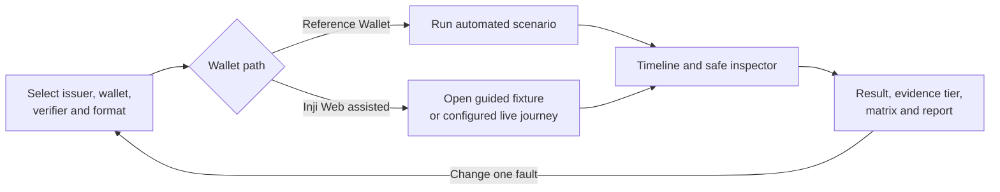
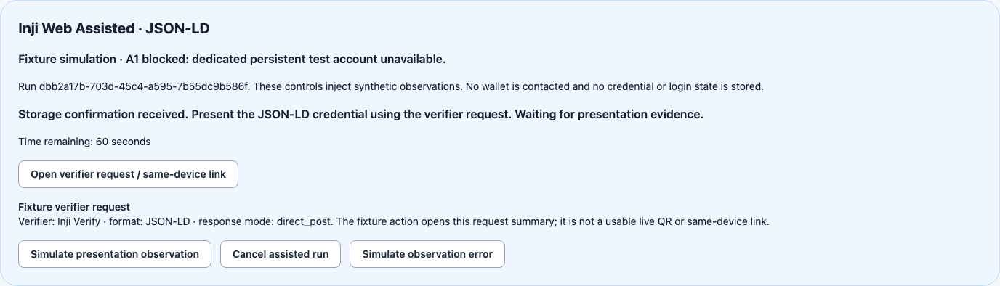
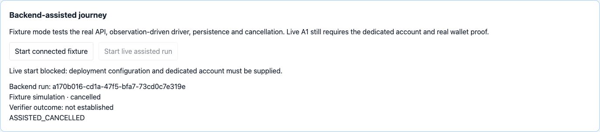
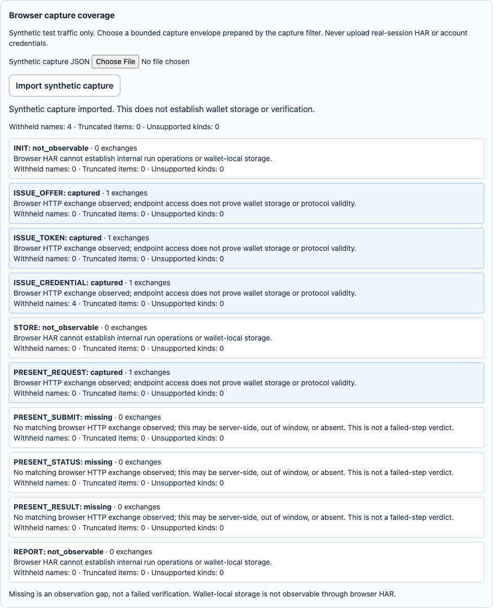
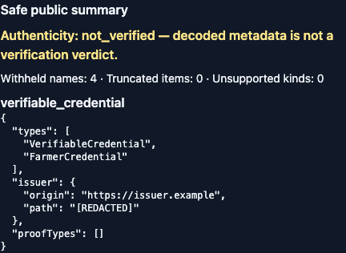

# UI flow and annotated screens

These screenshots come from the synthetic Playwright fixture/mock tests on 23 October 2026. They document navigation and evidence presentation; they do **not** show a real Inji-wallet pass. The source UI is in `apps/web/src/` and the browser checks are in `apps/web/browser/assisted.pw.ts`.

## 1. Guided assisted fixture

The guided panel exposes wallet and offer actions in keyboard order. Its confirmation and verifier buttons are labeled as simulated fixture steps. A completed fixture does not turn into real-wallet evidence; the [later managed Web run](evidence/person2-managed-a1-2026-10-25/run-report.json) has separate evidence.

## 2. Connected backend-assisted journey

The connected panel creates a backend run, shows stage-specific actions, supports cancellation and reconnects through run history after reload. Live mode requires HTTPS endpoint and capture-bridge configuration on the running BFF. A signed-in test account exists on the wallet operator's machine; it is not configured in this synthetic screenshot. A human storage confirmation alone is not wallet persistence proof.

## 3. Browser capture coverage

The coverage panel distinguishes captured, missing and `not_observable` steps. A passive synthetic HAR cannot reveal server-to-server requests or native-wallet traffic. The panel therefore keeps those boundaries visible instead of presenting a complete trace.

## 4. Safe public inspector

The inspector can display safe public credential metadata such as type and issuer while withholding claim values and raw tokens. The browser regression checks that planted canary values do not appear in the API or page after capture import.

The browser suite includes a keyboard traversal check and scoped axe WCAG 2 A/AA and 2.1 AA checks for these panels. The committed machine-readable results are [fixture accessibility](evidence/person2/accessibility.json), [capture accessibility](evidence/person2/capture-accessibility.json) and [connected accessibility](evidence/person2/connected-accessibility.json). Zero scoped violations were observed; this is not a full-site accessibility certification.
